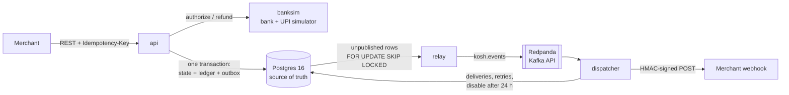

# Kosh

Kosh is a payments core in Go and Postgres. It takes merchant orders, collects payments through a simulated bank and UPI switch, records every rupee in a double-entry ledger, and tells merchants what happened through signed webhooks. The point of the project is correctness under failure. Clients retry, banks time out, and processes die between two writes, and Kosh still never double-captures, never loses an event, and never lets a merchant balance go negative. Eleven invariants written as SQL are checked after every test.

Kosh (कोष) means treasury.

> **Status: Gate 1 of 2.** Phases 1–3 of the [build plan](IMPLEMENTATION_PLAN.md) are done: the ledger, payments with idempotency, and events with webhooks. Settlement, reconciliation, the simulation harness, load tests and the dashboard come next. Progress is tracked in [progress.md](progress.md).

## Architecture



Postgres is the only source of truth. A state change, its ledger entry and the outbox event announcing it commit in one transaction, before anything leaves the system. The relay copies outbox rows to Kafka. The dispatcher turns each event into a delivery row and retries it until the merchant answers 2xx. Each binary runs on its own, so each can be killed on its own.

## Numbers

These are measured, not targets. Hardware: Intel Core i5-13450HX (10 cores / 16 threads), 16 GB RAM, Windows 11, with Postgres 16 in Docker Desktop (WSL 2) at default settings (`fsync` on). Each run lasted 15 seconds; reproduce with `go run ./cmd/ledgerbench -mode <mode> -workers <n>`.

| Ledger workload | Workers | Throughput | p50 | p99 |
| --- | --- | --- | --- | --- |
| Transfers between random accounts (no shared rows) | 1 | 178 /s | 5.5 ms | 8.8 ms |
| Transfers between random accounts (no shared rows) | 16 | 1,928 /s | 7.6 ms | 22.4 ms |
| Transfers between random accounts (no shared rows) | 32 | 2,141 /s | 12.5 ms | 43.6 ms |
| Every transfer credits one merchant (hot account) | 16 | 318 /s | 11.8 ms | 693 ms |
| Capture-shaped entries (receivable, merchant, fee, GST) | 16 | 278 /s | 12.5 ms | 576 ms |

The last row is the interesting one. Every capture debits `bank_receivable` and credits `fee_revenue` and `gst_payable`. Those three rows are shared by every payment in the system, so captures serialize on their row locks. Throughput drops 7× and p99 goes from 22 ms to over half a second. That is the hot-account problem, measured. [ADR 0003](docs/adr/0003-pessimistic-locking.md) explains why the locking is built this way and the planned fix (sharded system accounts).

Correctness so far: the SQL invariants hold at the end of every database test. Those tests include 50 goroutines making crossing transfers, 10 concurrent refunds on one payment, crashes at every named crashpoint, and a test that kills the real `relay` and `dispatcher` processes (60 events delivered, 30 duplicates, 0 lost). A separate in-memory property test checks the balance and limit rules after each of 1,000,000 random steps.

## The ledger in one example

A ₹1,000 UPI payment from a merchant on a 2% fee, with 18% GST charged on the fee:

| Account | Debit (paise) | Credit (paise) |
| --- | ---: | ---: |
| bank_receivable | 1,00,000 | |
| merchant_payable (Chai Point) | | 97,640 |
| fee_revenue | | 2,000 |
| gst_payable | | 360 |
| **Total** | **1,00,000** | **1,00,000** |

Amounts are `BIGINT` paise everywhere; there are no floats anywhere near money. Fee and GST are rounded half-up to the paisa, and the merchant's line absorbs the rounding, so an entry always balances exactly ([rules](internal/money/money.go)). Ledger rows are append-only, and Postgres triggers reject any `UPDATE` or `DELETE` on them. A correction is always a new entry.

A refund is a two-phase hold. Kosh reserves the amount on the merchant's balance (`pending_dr`), calls the bank, then posts or voids the hold exactly once. Fees are not returned on refunds, so a merchant whose only sale was ₹1,000 can refund at most ₹976.40. The API refuses the rest with `insufficient_balance` instead of letting the balance go negative.

## Invariants

These are the spec. Each is a SQL query in [`invariants/`](invariants) that returns violating rows. Tests run all of them, and later the simulation harness will run them after every step.

| # | Rule | Status |
| --- | --- | --- |
| 1 | Every journal entry balances, and so does the whole ledger | checked |
| 2 | Each account's stored balances equal the sum of its postings | checked |
| 3 | A payment is captured at most once | checked |
| 4 | `refunded ≤ amount` for every payment, even under concurrent refunds | checked |
| 5 | A merchant's payable never goes negative, counting pending holds | checked |
| 6 | Same idempotency key + same body → same response; different body → 422, nothing written | checked (SQL + replay tests) |
| 7 | Every state change writes exactly one outbox event, in the same transaction | checked |
| 8 | Every event reaches each enabled merchant at least once | checked at quiescence |
| 9 | A hold resolves at most once and expires by its deadline | enforced and tested; SQL check in phase 4 |
| 10 | Every captured payment matches a bank settlement line or is in the exception queue by T+2 | phase 5 |
| 11 | Posted entries are never updated or deleted | enforced by triggers, checked |

## How the hard parts work

- **Idempotency** uses Stripe's "atomic phases". A payment request runs in three steps: (A) a transaction that creates the payment and records a recovery point, (B) the bank call, which is idempotent on Kosh's payment id, and (C) a transaction that applies the bank's answer and stores the response. If the process dies between steps, a retry with the same key waits for the dead request's lease to expire, then resumes from the recovery point. Replays return the stored bytes exactly. Leases carry a random fencing token, so a request that lost its lease can never commit.
- **Concurrency.** Every payment state change is one guarded `UPDATE … WHERE state = $expected`. Ledger accounts are locked in ascending id order, so two entries can never deadlock. Concurrent refunds are serialized on the payment row and bounded by `refunded + x ≤ amount`.
- **Bank timeouts** leave a payment `pending`, never `failed`: a timeout means "unknown", and the money may have moved. Phase 4 adds the poller that resolves them.
- **Events** use a transactional outbox, not dual writes. The relay publishes rows and marks them published only after Kafka acknowledges them. A crash in between republishes the batch, so delivery is at-least-once. The dispatcher dedupes with `ON CONFLICT`, and merchants dedupe by event id.
- **Webhooks** are signed with `Kosh-Signature: t=<unix>,v1=<HMAC-SHA256(secret, t.body)>`. Retries use exponential backoff from 10 s to 1 h with jitter. A merchant failing for 24 hours is paused until it calls `POST /v1/webhooks/replay`.

More in [docs/DESIGN.md](docs/DESIGN.md) and the [ADRs](docs/adr).

## Run it

You need Go 1.25+ and Docker.

```bash
docker compose up -d --wait
```

```bash
go test -race ./...
```

The Kafka kill test runs only when brokers are set: `KOSH_KAFKA_BROKERS=localhost:19092 go test ./e2e/`. Postgres listens on host port 5442 and Redpanda on 19092.

Start the services, each in its own terminal (or build them into `bin/` with `go build -o bin/ ./cmd/...`):

```bash
go run ./cmd/banksim
```

```bash
KOSH_ADMIN_TOKEN=dev-admin go run ./cmd/api
```

```bash
go run ./cmd/relay
```

```bash
go run ./cmd/dispatcher
```

Onboard a merchant. The response carries the API key and webhook secret, and is the only time you see them:

```bash
curl -s -X POST localhost:8090/admin/merchants -H "Authorization: Bearer dev-admin" -d '{"name":"Chai Point","webhook_url":"http://localhost:8092/webhooks"}'
```

Run the sample receiver with that secret:

```bash
SAMPLE_SECRET=whsec_... go run ./cmd/samplemerchant
```

Then take a payment. Every POST needs an `Idempotency-Key`, and amounts are in paise:

```bash
curl -s -X POST localhost:8090/v1/orders -H "Authorization: Bearer $KEY" -H "Idempotency-Key: order-1" -d '{"amount":100000}'
```

```bash
curl -s -X POST localhost:8090/v1/payments -H "Authorization: Bearer $KEY" -H "Idempotency-Key: pay-1" -d '{"order_id":"<order id>","method":"upi"}'
```

```bash
curl -s -X POST localhost:8090/v1/payments/<payment id>/capture -H "Authorization: Bearer $KEY" -H "Idempotency-Key: cap-1"
```

```bash
curl -s -X POST localhost:8090/v1/payments/<payment id>/refunds -H "Authorization: Bearer $KEY" -H "Idempotency-Key: ref-1" -d '{"amount":25000}'
```

Send the payment request again with the same key and you get the same bytes back. Change the body and you get 422. `curl localhost:8092/admin/stats` shows what the merchant received. To make the bank misbehave:

```bash
curl -X PUT localhost:8091/admin/config -d '{"fail_rate":0.1,"timeout_rate":0.1,"latency_min_ms":5,"latency_max_ms":50,"hang_for_ms":35000}'
```

## Where it breaks

These are known limits, not bugs. Most are scheduled.

- **Hot system accounts.** Every capture locks the same three rows (see Numbers). Sharding `bank_receivable`, `fee_revenue` and `gst_payable` into N sub-accounts is planned for phase 6.
- **Pending payments are not resolved yet.** A bank timeout leaves a payment `pending` until the phase 4 status poller exists. The money is safe (nothing is posted), but the payment stays stuck.
- **Event order across relays.** With one relay, each payment's events reach Kafka in order. With several relays, batches can interleave. Every envelope carries the aggregate's `version`, so receivers can drop stale updates.
- **At-least-once means duplicates.** The kill test delivered 30 duplicates for 60 events. Merchants must dedupe by `Kosh-Event-Id`.
- **Determinism.** Postgres runs for real in every test. The app layer is deterministic (clock, ids, randomness and the bank all sit behind interfaces), but concurrent runs are not replayable step by step.
- **Windows numbers.** Docker Desktop adds a network hop per round trip, and each ledger post makes four. Expect better single-worker latency on Linux.

## Out of scope

There is no real bank, UPI or card network, and no real money. There is no card storage and no PCI scope. KYC, disputes and chargebacks are out (disputes are a stretch goal), and so are multi-currency (INR only) and multi-region.

## Repository

```text
cmd/            api, banksim, relay, dispatcher, samplemerchant, ledgerbench
internal/
  money/        paise type, fee and GST rounding
  ledger/       accounts, entries, holds, ordered locking
  payments/     state machine, orders, payments, refunds, replay
  idempotency/  atomic phases, leases, stored responses
  outbox/       transactional outbox and relay
  bus/          Kafka (franz-go) and in-memory log
  webhooks/     signing, dispatcher, retries, reference receiver
  bank/         bank client interface, HTTP client, scripted fake
  banksim/      bank simulator
  crash/        named crashpoints
  clock/ ids/ rng/  injectable time, ids and randomness
invariants/     one SQL file per invariant + checker
migrations/     embedded SQL migrations
e2e/            kills real processes
docs/           DESIGN.md, adr/
```
