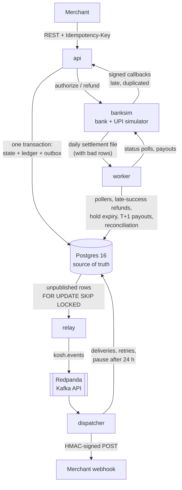
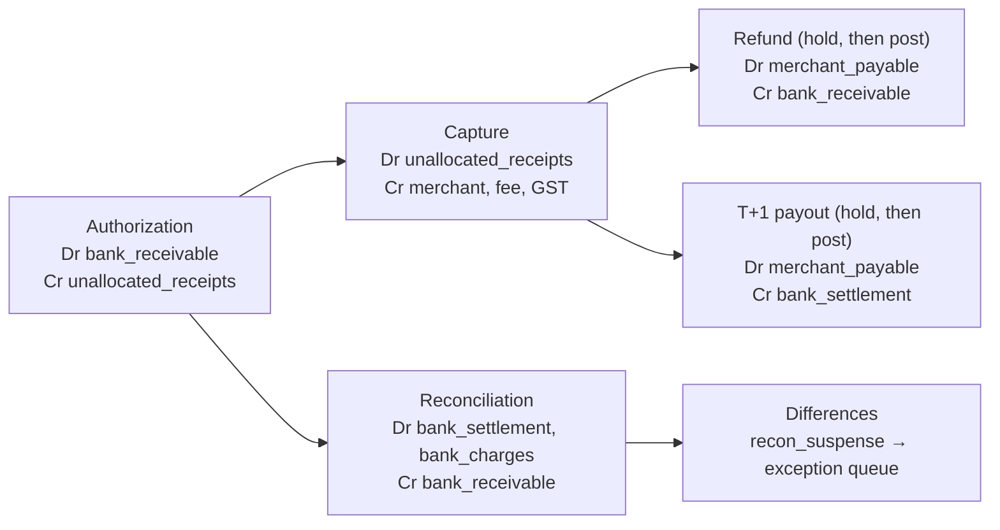
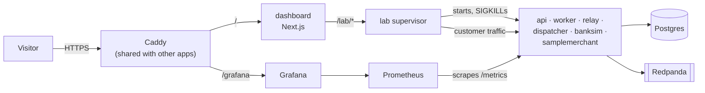

# Kosh

Kosh is a payments core in Go and Postgres. It takes merchant orders, collects payments through a simulated bank and UPI switch, records every rupee in a double-entry ledger, and tells merchants what happened through signed webhooks. The point of the project is correctness under failure. Clients retry, banks time out, and processes die between two writes, and Kosh still never double-captures, never loses an event, and never lets a merchant balance go negative. Eleven invariants written as SQL are checked after every test.

Kosh (कोष) means treasury.

> **Live failure lab: https://kosh.namankundra.com**: kill processes, break the bank, take the merchant down, and watch the ledger stay balanced. Metrics are at [/grafana](https://kosh.namankundra.com/grafana/).
>
> **Status: phase 6 of 6 built and deployed; final load numbers still to measure.** The [build plan](IMPLEMENTATION_PLAN.md)'s ledger, payments with idempotency, events with webhooks, bank chaos with T+1 settlement, reconciliation, the simulation harness, metrics, the failure lab and the deploy are built. Progress is in [progress.md](progress.md) and the queue in [NEXT.md](NEXT.md).

## What's built

| Area | What it does | Where |
| --- | --- | --- |
| Ledger | Double-entry bookkeeping in integer paise; append-only, enforced by triggers; accounts locked in id order; holds that post or void exactly once; balance limits; hot system accounts split into 16 shards | `internal/ledger`, `internal/money` |
| Payments API | Merchants, API keys, orders, payments, capture, partial and full refunds; a guarded state machine; every POST idempotent (atomic phases, fenced leases, byte-identical replays) | `cmd/api`, `internal/payments`, `internal/idempotency` |
| Bank and UPI simulator | Declines, timeouts, answers decided later, outages, signed late and duplicate callbacks, payouts, daily settlement files with injected bad rows | `cmd/banksim`, `internal/banksim` |
| Recovery worker | Polls the bank for every answer still owed, refunds late successes automatically, expires holds only after asking the bank, pays merchants on T+1, reconciles yesterday's bank file | `cmd/worker`, `internal/worker` |
| Events and webhooks | Transactional outbox, relay to Redpanda (Kafka API), dispatcher with HMAC-signed deliveries, backoff, 24-hour pause, replay API | `cmd/relay`, `cmd/dispatcher`, `internal/outbox`, `internal/webhooks` |
| Reconciliation | Matches every bank line to the ledger in six statuses, posts one cash entry per file, sends differences to a suspense account, and keeps an exception queue resolved by adjusting entries | `internal/recon` |
| Correctness | 11 invariants as SQL; property, race, crash and chaos tests; a test that kills real processes; a deterministic simulation harness with seed replay (200 seeds in CI) | `invariants/`, `sim/`, `e2e/`, `cmd/sim` |
| Observability | Prometheus metrics in every process and a provisioned Grafana dashboard | `internal/metrics`, `deploy/` |
| Failure lab | A supervisor that runs every process, plus a dashboard to kill processes, break the bank or the merchant, and drive traffic while the ledger is watched live | `cmd/lab`, `dashboard/` |
| Load and benchmarks | k6 scenarios (steady, one hot merchant, webhook fan-out) and a ledger benchmark | `loadtest/`, `cmd/ledgerbench` |
| Deploy | One Docker image for all binaries, compose profiles, Caddy with HTTPS, a VM deploy kit; live on a shared GCP VM | `Dockerfile`, `docker-compose.yml`, `deploy/` |

## Architecture



Postgres is the only source of truth. A state change, its ledger entry and the outbox event announcing it commit in one transaction, before anything leaves the system. The relay copies outbox rows to Kafka. The dispatcher turns each event into a delivery row and retries it until the merchant answers 2xx. The worker chases every answer the bank still owes, pays merchants on T+1, and reconciles the bank's settlement file every day. Each binary runs on its own, so each can be killed on its own.

### How a payment's money moves



### How it runs live



The lab runs every Kosh process as a child, so the dashboard can kill any of them, switch the bank or the merchant's endpoint into a failure mode, and drive traffic, while it re-checks the invariants every five seconds. On the shared VM every container has CPU and memory caps, and only the dashboard and Grafana are reachable through Caddy.

## Numbers

These are measured, not targets. Hardware: Intel Core i5-13450HX (10 cores / 16 threads), 16 GB RAM, Windows 11, with Postgres 16 in Docker Desktop (WSL 2) at default settings (`fsync` on). Each run lasted 15 seconds; reproduce with `go run ./cmd/ledgerbench -mode <mode> -workers <n>`.

| Ledger workload | Workers | Throughput | p50 | p99 |
| --- | --- | --- | --- | --- |
| Transfers between random accounts (no shared rows) | 1 | 178 /s | 5.5 ms | 8.8 ms |
| Transfers between random accounts (no shared rows) | 16 | 1,928 /s | 7.6 ms | 22.4 ms |
| Transfers between random accounts (no shared rows) | 32 | 2,141 /s | 12.5 ms | 43.6 ms |
| Every transfer credits one merchant (hot account) | 16 | 318 /s | 11.8 ms | 693 ms |
| Capture-shaped entries (receivable, merchant, fee, GST) | 16 | 278 /s | 12.5 ms | 576 ms |

The last row is the interesting one. Every capture debits `bank_receivable` and credits `fee_revenue` and `gst_payable`. Those three rows are shared by every payment in the system, so captures serialize on their row locks. Throughput drops 7× and p99 goes from 22 ms to over half a second. That is the hot-account problem, measured. [ADR 0003](docs/adr/0003-pessimistic-locking.md) explains why the locking is built this way. The fix, sharding those accounts by payment id, is now built; its before/after measurement is next in [NEXT.md](NEXT.md).

**Simulation: 5,200 of 10,000 seeds done with 0 failures so far (the full run is still going; 200 seeds also pass on every CI run).** Each seed is a fresh database and a seeded world (workload, ids, clock, retry jitter, and an in-process bank that declines, times out, answers late, goes down and sends duplicate callbacks). It runs 60 random steps, including crashes at named crashpoints, with every invariant checked after every step, then drains and checks all 11. Seeds replay exactly: `go run ./cmd/sim -seed 42 -v`. Planting any of four bugs by hand made between 9 and 39 of 40 seeds fail, so the harness does catch bugs.

**Reconciliation:** on a day of 300 payments and 20 refunds, with a bank file salted with fee-variance, missing, duplicate and amount-mismatch rows, recon classified 320 of 320 lines and injected faults correctly (`TestReconAccuracy`).

The SQL invariants also hold at the end of every database test. Those tests include 50 goroutines making crossing transfers, 10 concurrent refunds on one payment, crashes at every named crashpoint, and a test that kills the real `relay` and `dispatcher` processes (60 events delivered, 30 duplicates, 0 lost). A separate in-memory property test checks the balance and limit rules after each of 1,000,000 random steps.

The bank chaos test (`TestBankChaos`) runs about 100 payments, refunds and a day's settlement over HTTP against a bank that declines 10%, times out 10%, answers "pending" 25%, goes down every 600 ms, and sends each callback up to 4 times. A typical run has around 15 late successes auto-refunded and 250 callbacks applied, and every invariant holds afterwards. It found two real bugs on its first runs (see [progress.md](progress.md#bugs-caught-by-tests)).

## The ledger in one example

A ₹1,000 UPI payment from a merchant on a 2% fee, with 18% GST charged on the fee. When the bank authorizes it, the customer's money is held, belonging to nobody yet:

| Account | Debit (paise) | Credit (paise) |
| --- | ---: | ---: |
| bank_receivable | 1,00,000 | |
| unallocated_receipts | | 1,00,000 |

Capture allocates it:

| Account | Debit (paise) | Credit (paise) |
| --- | ---: | ---: |
| unallocated_receipts | 1,00,000 | |
| merchant_payable (Chai Point) | | 97,640 |
| fee_revenue | | 2,000 |
| gst_payable | | 360 |
| **Total** | **1,00,000** | **1,00,000** |

When the bank's settlement file arrives, reconciliation clears `bank_receivable` into `bank_settlement` (cash), less the bank's own charges ([ADR 0006](docs/adr/0006-receivable-at-authorization.md) explains the split).

Amounts are `BIGINT` paise everywhere; there are no floats anywhere near money. Fee and GST are rounded half-up to the paisa, and the merchant's line absorbs the rounding, so an entry always balances exactly ([rules](internal/money/money.go)). Ledger rows are append-only, and Postgres triggers reject any `UPDATE` or `DELETE` on them. A correction is always a new entry.

A refund is a two-phase hold. Kosh reserves the amount on the merchant's balance (`pending_dr`), calls the bank, then posts or voids the hold exactly once. Fees are not returned on refunds, so a merchant whose only sale was ₹1,000 can refund at most ₹976.40. The API refuses the rest with `insufficient_balance` instead of letting the balance go negative.

## Invariants

These are the spec. Each is a SQL query in [`invariants/`](invariants) that returns violating rows. Tests run all of them, and the simulation harness runs them after every step.

| # | Rule | Status |
| --- | --- | --- |
| 1 | Every journal entry balances, and so does the whole ledger | checked |
| 2 | Each account's stored balances equal the sum of its postings | checked |
| 3 | A payment is captured at most once | checked |
| 4 | `refunded ≤ amount` for every payment, even under concurrent refunds | checked |
| 5 | A merchant's payable never goes negative, counting pending holds | checked |
| 6 | Same idempotency key + same body → same response; different body → 422, nothing written | checked (SQL + replay tests) |
| 7 | Every state change writes exactly one outbox event, in the same transaction | checked |
| 8 | Every event reaches each enabled merchant at least once | checked at quiescence |
| 9 | A hold resolves at most once and expires by its deadline | checked |
| 10 | Every captured payment matches a bank settlement line or is in the exception queue by T+2 | checked |
| 11 | Posted entries are never updated or deleted | enforced by triggers, checked |

## How the hard parts work

- **Idempotency** uses Stripe's "atomic phases". A payment request runs in three steps: (A) a transaction that creates the payment and records a recovery point, (B) the bank call, which is idempotent on Kosh's payment id, and (C) a transaction that applies the bank's answer and stores the response. If the process dies between steps, a retry with the same key waits for the dead request's lease to expire, then resumes from the recovery point. Replays return the stored bytes exactly. Leases carry a random fencing token, so a request that lost its lease can never commit.
- **Concurrency.** Every payment state change is one guarded `UPDATE … WHERE state = $expected`. Ledger accounts are locked in ascending id order, so two entries can never deadlock. Concurrent refunds are serialized on the payment row and bounded by `refunded + x ≤ amount`.
- **Bank answers** arrive three ways: the API's own call, a signed callback (late and possibly repeated), and the worker's status poll. All three go through one resolver that locks the payment and decides from its current state. A timeout means "unknown", never "failed". A payment the bank never received is failed. One still pending after 30 minutes is failed too, and if the bank says success after that, the **late success** is recorded and an **auto refund** sends the money back to the customer.
- **Hold deadlines are not commit deadlines.** If the bank confirms a refund or payout after its hold's deadline, the money still moved, so the hold is committed anyway. Expiry asks the bank before it voids anything ([ADR 0005](docs/adr/0005-hold-deadlines.md)).
- **Reconciliation** reads the bank's daily file and matches each line to a bank-confirmed payment or refund, by bank reference and then by Kosh's id. It classifies each one as `matched`, `fee_variance`, `amount_mismatch`, `duplicate`, `missing_in_ledger`, or (for an item that never showed up by T+2) `missing_in_bank`. One entry per file moves cash into `bank_settlement`. Every difference goes to `recon_suspense`, and resolving an exception posts an adjusting entry; nothing is edited. A missing item that turns up later closes its own exception.
- **The simulation harness** (`sim/`) runs one goroutine against a fake clock and a seeded bank, so a seed fixes the whole run, and a trace hash proves a replay matched. Postgres is real and is not replayed; with one goroutine, nothing in it races.
- **Hot accounts are sharded.** The four system accounts every payment touches have 16 shards each, picked from the payment id, so payments stop queueing on one row lock (ADR 0003). The before/after numbers are next in [NEXT.md](NEXT.md).
- **The failure lab** (`cmd/lab` plus `dashboard/`) runs every process as a child, so the dashboard can SIGKILL any of them, switch the bank into flaky, late or outage mode, break the merchant's endpoint, and drive traffic, while it re-checks the invariants every 5 s.
- **T+1 settlement.** Each merchant is paid its available balance minus the credits it earned today, so refunds and open holds are netted out and today's sales wait for tomorrow. A payout is a two-phase hold: it posts on bank success and voids on failure, and a failed payout is picked up by the next day's batch. Payouts never time out: failing one the bank later completes would pay twice.
- **Events** use a transactional outbox, not dual writes. The relay publishes rows and marks them published only after Kafka acknowledges them. A crash in between republishes the batch, so delivery is at-least-once. The dispatcher dedupes with `ON CONFLICT`, and merchants dedupe by event id.
- **Webhooks** are signed with `Kosh-Signature: t=<unix>,v1=<HMAC-SHA256(secret, t.body)>`. Retries use exponential backoff from 10 s to 1 h with jitter. A merchant failing for 24 hours is paused until it calls `POST /v1/webhooks/replay`.

More in [docs/DESIGN.md](docs/DESIGN.md) and the [ADRs](docs/adr).

## Run it

You need Go 1.25+ and Docker.

```bash
docker compose up -d --wait
```

```bash
go test -race ./...
```

The Kafka kill test runs only when brokers are set: `KOSH_KAFKA_BROKERS=localhost:19092 go test ./e2e/`. Postgres listens on host port 5442 and Redpanda on 19092.

Start the services, each in its own terminal (or build them into `bin/` with `go build -o bin/ ./cmd/...`):

```bash
go run ./cmd/banksim
```

```bash
KOSH_ADMIN_TOKEN=dev-admin KOSH_BANK_CALLBACK_SECRET=cb-secret go run ./cmd/api
```

```bash
go run ./cmd/worker
```

```bash
go run ./cmd/relay
```

```bash
go run ./cmd/dispatcher
```

Onboard a merchant. The response carries the API key and webhook secret, and is the only time you see them:

```bash
curl -s -X POST localhost:8090/admin/merchants -H "Authorization: Bearer dev-admin" -d '{"name":"Chai Point","webhook_url":"http://localhost:8092/webhooks"}'
```

Run the sample receiver with that secret:

```bash
SAMPLE_SECRET=whsec_... go run ./cmd/samplemerchant
```

Then take a payment. Every POST needs an `Idempotency-Key`, and amounts are in paise:

```bash
curl -s -X POST localhost:8090/v1/orders -H "Authorization: Bearer $KEY" -H "Idempotency-Key: order-1" -d '{"amount":100000}'
```

```bash
curl -s -X POST localhost:8090/v1/payments -H "Authorization: Bearer $KEY" -H "Idempotency-Key: pay-1" -d '{"order_id":"<order id>","method":"upi"}'
```

```bash
curl -s -X POST localhost:8090/v1/payments/<payment id>/capture -H "Authorization: Bearer $KEY" -H "Idempotency-Key: cap-1"
```

```bash
curl -s -X POST localhost:8090/v1/payments/<payment id>/refunds -H "Authorization: Bearer $KEY" -H "Idempotency-Key: ref-1" -d '{"amount":25000}'
```

Send the payment request again with the same key and you get the same bytes back. Change the body and you get 422. `curl localhost:8092/admin/stats` shows what the merchant received. To make the bank misbehave and send callbacks:

```bash
curl -X PUT localhost:8091/admin/config -d '{"fail_rate":0.1,"timeout_rate":0.1,"pending_rate":0.2,"final_after_ms":2000,"latency_min_ms":5,"latency_max_ms":50,"hang_for_ms":35000,"callback_url":"http://localhost:8090/bank/callbacks","callback_secret":"cb-secret","callback_delay_ms":100,"max_duplicate_callbacks":3}'
```

Add `"outage": true` to take the bank down. The worker pays merchants for yesterday automatically. To run a day by hand:

```bash
curl -s -X POST localhost:8090/admin/settlements/run -H "Authorization: Bearer dev-admin" -d '{"date":"2026-10-17"}'
```

The bank's settlement file for a day, with its injected bad rows, is at `localhost:8091/v1/settlements/<date>`, and the list of what was injected is at `/admin/settlements/<date>/faults`. The worker reconciles yesterday's file automatically. To do it by hand and work the exception queue:

```bash
curl -s -X POST localhost:8090/admin/recon/run -H "Authorization: Bearer dev-admin" -d '{"date":"2026-10-17"}'
```

```bash
curl -s localhost:8090/admin/recon/exceptions -H "Authorization: Bearer dev-admin"
```

```bash
curl -s -X POST localhost:8090/admin/recon/exceptions/1/resolve -H "Authorization: Bearer dev-admin" -d '{"action":"write_off"}'
```

Run the failure lab locally (build the binaries into `bin/` first), with the dashboard at localhost:3005:

```bash
go build -o bin/ ./cmd/...
```

```bash
./bin/lab
```

```bash
npm --prefix dashboard install && npm --prefix dashboard run dev
```

Or run everything in containers, with Prometheus at localhost:9090 and Grafana at localhost:3002:

```bash
docker compose --profile stack up -d --build
```

Run the simulation (each seed takes a fresh database from the compose Postgres):

```bash
go run ./cmd/sim -seeds 200 -parallel 8
```

```bash
go run ./cmd/sim -seed 42 -v
```

## Where it breaks

These are known limits, not bugs. Most are scheduled.

- **One hot merchant.** System accounts are now sharded, but a single merchant's own payable can't be split without breaking "never negative", so one very busy merchant still serializes on its row. Batched postings are the planned option (NEXT.md).
- **Exceptions wait for a human.** Recon surfaces every disagreement (a refund the bank completed after Kosh gave up on it shows up as `missing_in_ledger`), but nothing alerts anyone or enforces an SLA on the queue. An auto refund the bank declines is not retried; its amount stays visible in `customer_refund_payable`.
- **Uncaptured authorizations are never released.** Gateways auto-refund an authorization that isn't captured within a few days; in Kosh the money stays in `unallocated_receipts`.
- **The simulation is single-goroutine.** That is what makes it replayable. Concurrency bugs are covered by the race-detector tests and `TestBankChaos` instead, and those are not replayable step by step.
- **A bank answer Kosh can't apply** (for example a reference that already belongs to another payment) leaves that one item pending and retrying with backoff. The rest of the batch carries on, but nobody is alerted yet.
- **Event order across relays.** With one relay, each payment's events reach Kafka in order. With several relays, batches can interleave. Every envelope carries the aggregate's `version`, so receivers can drop stale updates.
- **At-least-once means duplicates.** The kill test delivered 30 duplicates for 60 events. Merchants must dedupe by `Kosh-Event-Id`.
- **Determinism.** Postgres runs for real in every test. The app layer is deterministic (clock, ids, randomness and the bank all sit behind interfaces), but concurrent runs are not replayable step by step.
- **Windows numbers.** Docker Desktop adds a network hop per round trip, and each ledger post makes four. Expect better single-worker latency on Linux.

## Out of scope

There is no real bank, UPI or card network, and no real money. There is no card storage and no PCI scope. KYC, disputes and chargebacks are out (disputes are a stretch goal), and so are multi-currency (INR only) and multi-region.

## Repository

```text
cmd/            api, worker, banksim, relay, dispatcher, samplemerchant, lab, ledgerbench, sim
internal/
  money/        paise type, fee and GST rounding
  ledger/       accounts, entries, holds, ordered locking
  payments/     state machine, payments, refunds, bank-answer resolver, pollers, settlement, payouts
  recon/        settlement-file ingestion, matching, exception queue
  metrics/      Prometheus metrics
  worker/       background loop: pollers, hold expiry, daily settlement
  idempotency/  atomic phases, leases, stored responses
  outbox/       transactional outbox and relay
  bus/          Kafka (franz-go) and in-memory log
  webhooks/     signing, dispatcher, retries, reference receiver
  bank/         bank client interface, HTTP client, scripted fake
  banksim/      bank simulator: faults, callbacks, settlement files
  crash/        named crashpoints
  clock/ ids/ rng/  injectable time, ids and randomness
invariants/     one SQL file per invariant + checker
migrations/     embedded SQL migrations
sim/            deterministic simulation harness and its in-process bank
e2e/            kills real processes
dashboard/      the failure lab UI (Next.js)
loadtest/       k6 scenarios
deploy/         Prometheus, Grafana, Caddy, compose files and the VM deploy
docs/           DESIGN.md, adr/
```
