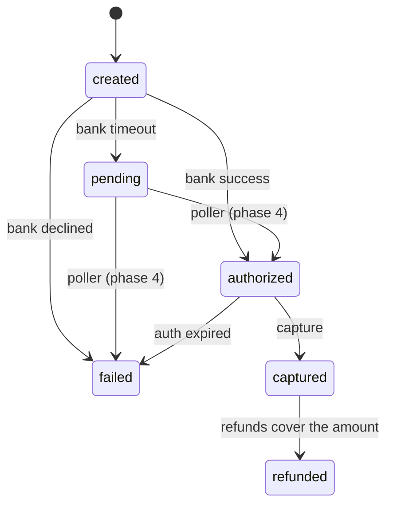

# Kosh design

This document covers how Kosh stays correct. The README covers what it does, and the ADRs in [adr/](adr) record the decisions with their alternatives.

## Principles

1. **One source of truth.** Postgres holds every money movement and every event. Nothing else (Kafka, Redis, a merchant) is ever authoritative.
2. **One transaction per fact.** A payment's state, its ledger entry and the outbox event announcing it commit together or not at all.
3. **Unknown is not failure.** A timed-out bank call means the money may have moved. Kosh records `pending` and asks again; it never guesses `failed`.
4. **Append, don't edit.** Ledger rows are immutable, and triggers enforce that. Corrections are new entries.
5. **Every rule is a query.** If a property matters, it is written as SQL in `invariants/` and checked after every test.

## Data model

| Table | Holds | Written by |
| --- | --- | --- |
| `accounts` | chart of accounts with running posted/pending totals and limit flags | ledger |
| `journal_entries`, `postings` | the ledger; append-only, `UNIQUE (kind, ref_id)` | ledger |
| `merchants`, `api_keys` | merchants, fee rates, webhook config; SHA-256 of API keys | admin API |
| `orders`, `payments`, `refunds` | the payment lifecycle, with a `version` per row | payments |
| `idempotency_keys` | leases, recovery points and stored responses | idempotency |
| `outbox` | one row per state change, `UNIQUE (aggregate_id, aggregate_version)` | payments |
| `webhook_deliveries` | one row per (event, merchant), with retry state | dispatcher |

## Money flow

| Event | Debit | Credit | Entry |
| --- | --- | --- | --- |
| Capture | `bank_receivable` amount | `merchant_payable` net, `fee_revenue` fee, `gst_payable` GST | posted |
| Refund requested | `merchant_payable` amount | `bank_receivable` amount | **pending** hold |
| Refund succeeded | (hold moves pending → posted) | | posted |
| Refund failed or expired | (hold voided, pending totals released) | | voided |

`merchant_payable` carries `DebitsMustNotExceedCredits`, which is checked against posted plus pending debits. A hold reserves money, and a refund the merchant can't cover is refused before the bank is ever called.

## Payment lifecycle



Every arrow is one call to `transition(tx, id, from, to)`:

```sql
UPDATE payments SET state = $to, version = version + 1, …
WHERE id = $id AND state = $from
RETURNING …
```

Zero rows means a lost race or an illegal request, and the caller gets a typed error. The same function writes the outbox event for the new version, so invariant 7 holds by construction. Invariant 3 is held twice: once by the guard and once by `journal_entries UNIQUE (kind, ref_id)`.

## Idempotency: atomic phases

```text
Acquire(key)          INSERT … ON CONFLICT; compare request hash; take a lease (random lease_id)
  Phase A  (tx)       lock order, insert payment 'created', outbox event, Advance(recovery_point='payment_created')
  Phase B             bank.Authorize(payment_id)        ← idempotent at the bank
  Phase C  (tx)       transition to authorized/failed/pending, outbox event, Finish(response bytes)
```

| What a retry finds | Result |
| --- | --- |
| `done` | the stored response, byte for byte (the column is `JSON`, not `JSONB`, so key order survives) |
| `in_progress`, lease fresh | 409 `idempotency_key_in_use` |
| `in_progress`, lease older than 60 s | take over the lease, resume at the recovery point |
| different request hash | 422 `idempotency_key_reused`, nothing written |

Every write after Acquire includes `WHERE lease_id = $mine`. A request that stalled past its lease and was taken over cannot commit later. Deterministic 4xx errors are stored and replayed. 5xx errors release the lease so a retry resumes at once.

## Events and webhooks

```text
payments tx ──▶ outbox row
relay:       SELECT … WHERE published_at IS NULL FOR UPDATE SKIP LOCKED
             → Kafka (acks=all) → crashpoint relay.after_publish → UPDATE published_at
dispatcher:  consume → INSERT webhook_deliveries ON CONFLICT DO NOTHING
             → crashpoint dispatcher.after_ingest → commit offsets
             claim due rows (lease = 2 × send timeout) → POST → record result
```

Each crashpoint marks a place where dying creates a duplicate and never a loss:

| Crash at | What happens on restart | Tested by |
| --- | --- | --- |
| `relay.after_publish` | batch published again; dispatcher ignores known events | `TestRelayCrashAfterPublish`, `TestKillRelayAndDispatcher` |
| `dispatcher.after_ingest` | consumer re-reads from the last commit; inserts are no-ops | `TestDispatcherCrashAfterIngest` |
| `dispatcher.after_send` | lease expires, merchant gets the event again | `TestDispatcherCrashAfterSend`, `TestKillRelayAndDispatcher` |
| `payments.create.after_insert` / `after_bank` | retry resumes from the recovery point; bank dedupes by payment id | `TestCrashBetweenPhases` |
| `refunds.create.after_bank` | hold stays pending until the retry commits it | `TestCrashDuringRefund` |

Retries back off exponentially from 10 s to a 1 h cap. Each delay is half fixed and half random ("equal jitter"), so retries spread out without collapsing to zero. A merchant with no successful delivery for 24 h gets `webhook_disabled_at` and receives nothing until it calls `POST /v1/webhooks/replay`. `TestMerchantDown26Hours` runs that whole story on a fake clock in a few seconds.

## Testing approach

- Every test gets its own Postgres database, cloned from a migrated template in milliseconds.
- Time, ids, randomness, the bank and the webhook sender all sit behind interfaces, so tests run on a fake clock with scripted bank outcomes.
- Crashpoints are compiled into the binaries. `KOSH_CRASHPOINT=relay.after_publish` makes the process exit with status 137 at that line. In-process tests arm them with a panic instead.
- Each database test ends with `invariants.Check`, which runs all the SQL rules.
- The e2e test builds the real binaries, runs them against Redpanda, kills them, and checks that nothing was lost.

## Known gaps (Gate 1)

- No status poller yet, so `pending` payments wait for phase 4.
- No settlement or reconciliation; `bank_receivable` only grows. That is phases 4 and 5.
- Invariants 9 (as SQL) and 10 come later.
- The hot system accounts are measured but not yet fixed (ADR 0003).
