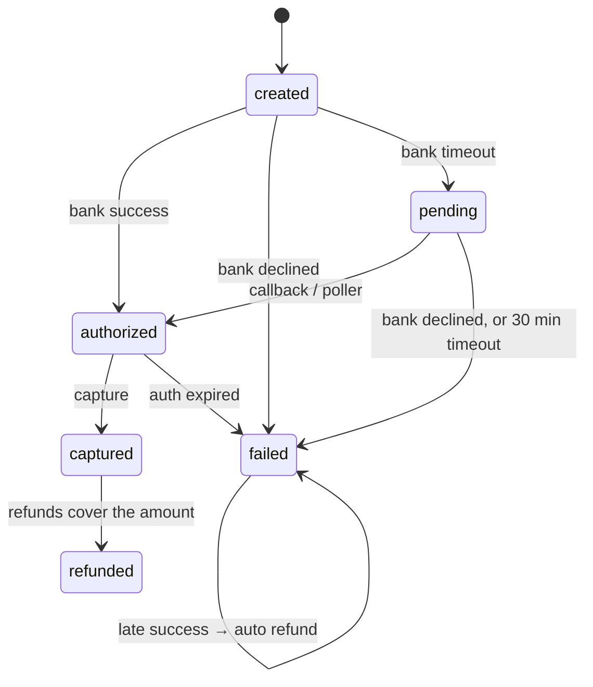

# Kosh design

This document covers how Kosh stays correct. The README covers what it does, and the ADRs in [adr/](adr) record the decisions with their alternatives.

## Principles

1. **One source of truth.** Postgres holds every money movement and every event. Nothing else (Kafka, Redis, a merchant) is ever authoritative.
2. **One transaction per fact.** A payment's state, its ledger entry and the outbox event announcing it commit together or not at all.
3. **Unknown is not failure.** A timed-out bank call means the money may have moved. Kosh records `pending` and asks again; it never guesses `failed`.
4. **Append, don't edit.** Ledger rows are immutable, and triggers enforce that. Corrections are new entries.
5. **Every rule is a query.** If a property matters, it is written as SQL in `invariants/` and checked after every test.

## Data model

| Table | Holds | Written by |
| --- | --- | --- |
| `accounts` | chart of accounts with running posted/pending totals and limit flags | ledger |
| `journal_entries`, `postings` | the ledger; append-only, `UNIQUE (kind, ref_id)` | ledger |
| `merchants`, `api_keys` | merchants, fee rates, webhook config; SHA-256 of API keys | admin API |
| `orders`, `payments`, `refunds` | the payment lifecycle, with a `version` per row | payments |
| `idempotency_keys` | leases, recovery points and stored responses | idempotency |
| `outbox` | one row per state change, `UNIQUE (aggregate_id, aggregate_version)` | payments |
| `webhook_deliveries` | one row per (event, merchant), with retry state | dispatcher |
| `payouts` | one per merchant per settlement date, with its hold | worker |
| `settlement_files`, `settlement_lines` | the bank's daily files, as received (checksummed) | recon |
| `recon_results` | one result per line, plus one per item the bank never settled; the open non-matched ones are the exception queue | recon |

## Money flow

| Event | Debit | Credit | Entry |
| --- | --- | --- | --- |
| Authorization (bank success) | `bank_receivable` amount | `unallocated_receipts` amount | posted |
| Capture | `unallocated_receipts` amount | `merchant_payable` net, `fee_revenue` fee, `gst_payable` GST | posted |
| Refund requested | `merchant_payable` amount | `bank_receivable` amount | **pending** hold |
| Refund succeeded | (hold moves pending → posted) | | posted |
| Refund failed or expired | (hold voided, pending totals released) | | voided |
| Late success (bank succeeded after Kosh failed the payment) | `bank_receivable` | `customer_refund_payable` | posted |
| Auto refund of a late success | `customer_refund_payable` | `bank_receivable` | **pending** hold, then posted |
| Payout initiated (T+1) | `merchant_payable` eligible amount | `payout_clearing` | **pending** hold |
| Payout confirmed by the bank | (hold posted) and `payout_clearing` | `bank_settlement` | posted |
| Payout rejected | (hold voided; tomorrow's batch pays it) | | voided |
| Bank settlement file reconciled (one entry per file) | `bank_settlement` net cash, `bank_charges` expected fees, `recon_suspense` shortfalls | `bank_receivable` expected gross, `recon_suspense` overpayments | posted |
| Exception resolved: written off | `recon_writeoff` | `recon_suspense` (or `bank_receivable` for a missing item) | posted |
| Exception resolved: bank corrected | `bank_settlement` | `recon_suspense` | posted |

`merchant_payable` carries `DebitsMustNotExceedCredits`, which is checked against posted plus pending debits. A hold reserves money, and a refund the merchant can't cover is refused before the bank is ever called.

## Payment lifecycle



Every arrow is one call to `transition(tx, id, from, to)`:

```sql
UPDATE payments SET state = $to, version = version + 1, …
WHERE id = $id AND state = $from
RETURNING …
```

Zero rows means a lost race or an illegal request, and the caller gets a typed error. The same function writes the outbox event for the new version, so invariant 7 holds by construction. Invariant 3 is held twice: once by the guard and once by `journal_entries UNIQUE (kind, ref_id)`.

## Idempotency: atomic phases

```text
Acquire(key)          INSERT … ON CONFLICT; compare request hash; take a lease (random lease_id)
  Phase A  (tx)       lock order, insert payment 'created', outbox event, Advance(recovery_point='payment_created')
  Phase B             bank.Authorize(payment_id)        ← idempotent at the bank
  Phase C  (tx)       transition to authorized/failed/pending, outbox event, Finish(response bytes)
```

| What a retry finds | Result |
| --- | --- |
| `done` | the stored response, byte for byte (the column is `JSON`, not `JSONB`, so key order survives) |
| `in_progress`, lease fresh | 409 `idempotency_key_in_use` |
| `in_progress`, lease older than 60 s | take over the lease, resume at the recovery point |
| different request hash | 422 `idempotency_key_reused`, nothing written |

Every write after Acquire includes `WHERE lease_id = $mine`. A request that stalled past its lease and was taken over cannot commit later. Deterministic 4xx errors are stored and replayed. 5xx errors release the lease so a retry resumes at once.

## Bank answers

The same answer can arrive three times, in any order: phase C of the request, a signed callback (`POST /bank/callbacks`, sent late and up to N times), and the worker's status poll. All three call one resolver per aggregate (`applyPaymentResult`, `resolveRefund`, `resolvePayout`). Each locks the row and decides from its *current* state, so a duplicate or stale answer is a no-op.

| Payment is | Bank says success | Bank says failed | Bank says pending / unknown |
| --- | --- | --- | --- |
| `created` / `pending` | → `authorized` | → `failed` | → `pending`, poll again |
| `failed` | late success → auto refund | nothing | nothing |
| `authorized` and later | nothing | nothing | nothing |

The pollers claim due rows with `FOR UPDATE SKIP LOCKED`, push their next poll out by an exponential backoff (5 s to 5 min), and ask `bank.Status`. A request the bank never received is failed (payments) or submitted now (refunds and payouts, which Kosh owes). A row that can't be applied is reported and retried, and the rest of the batch carries on.

## Settlement and payouts

For business day D (IST), the worker pays each merchant:

```text
eligible = posted credits − posted debits − pending debits − credits posted since the start of D+1
```

That nets out refunds and open holds, and leaves D+1's sales for tomorrow. The account row is locked in its own statement *before* this is computed: under READ COMMITTED, a `SELECT … FOR UPDATE` that waits on a lock re-reads the row but keeps its subqueries' old snapshot, which let a concurrent capture leak into yesterday's payout (`TestSettlementIgnoresConcurrentCapture`).

`UNIQUE (merchant_id, settlement_date)` makes the batch safe to repeat. Payouts run in phases like payments, and a crash after the hold leaves a `pending` payout that the poller submits. Holds and the bank's late confirmations follow [ADR 0005](adr/0005-hold-deadlines.md).

The bank simulator publishes a settlement file per day (`GET /v1/settlements/{date}`) with seeded faults, ready for phase 5's reconciliation.

## Reconciliation

The worker fetches yesterday's settlement file, ingests it (the same file twice is a no-op; a different file for the same date is refused), and reconciles it in one transaction:

1. Load the lines and every bank-confirmed payment or refund they could refer to, with whether each is already settled.
2. Match each line by `bank_ref`, then by Kosh's id echoed in `reference`, and classify it:

   | Status | When | Into `recon_suspense` |
   | --- | --- | --- |
   | `matched` | gross and fee agree | 0 |
   | `fee_variance` | gross agrees, fee differs from `bank.Fee` | expected net − actual net |
   | `amount_mismatch` | gross differs | expected net − actual net |
   | `duplicate` | item already settled | −net (cash with no item) |
   | `missing_in_ledger` | no item | −net |
   | `missing_in_bank` | (no line) item confirmed before the file's date, never settled | 0; the receivable stays open |

3. Post one `bank_settlement` entry for the file, and mark it reconciled.

Invariant 10 then says: everything confirmed before the latest reconciled date has a result, every line has exactly one, and `recon_suspense` equals the sum of the open exceptions.

## Simulation harness

`sim.Run(seed)` builds a world on a fresh database: the payments service and recon engine on a fake clock and seeded ids, an in-process bank (`sim.Bank`) with seeded decisions and a callback queue, the in-memory bus, the dispatcher with seeded jitter, a receiver per merchant, and the worker. Then it runs 60 steps chosen by the seed's RNG:

| Step | What it does |
| --- | --- |
| pay / retry | new order and payment; or resend any earlier request with its key, and require byte-identical bytes |
| capture / refund / double_refund | on payments picked from the database in id order |
| callbacks | deliver the bank's due callbacks (late; 0–3 copies) |
| advance | move the clock 1 s to 8 h |
| worker / events | a worker round (pollers, expiry, settlement, recon); relay, ingest and send |
| merchant_flip / bank_mood | break or fix a webhook endpoint; change the bank's decline, timeout, pending and outage rates |
| crash | arm a crashpoint and run the action that reaches it; on the panic, "restart" (fresh bus consumer, arms cleared) and let the client retry later |
| resolve | resolve a random open exception |

After every step, invariants 1–7 and 9–11 are checked against the fake clock. At the end the faults stop and the world drains for at least 50 simulated hours: every unanswered request is retried, callbacks delivered, payouts made, files reconciled, webhooks delivered (disabled merchants replay). Then all 11 invariants are checked, including 8.

Determinism needed a few things: every `ORDER BY` has a unique tiebreak, crashpoints are armed per context (`crash.WithArms`) so parallel seeds don't trigger each other, and the bus is drained by checking its lag rather than polling with a timeout. `TestReplayIsDeterministic` runs one seed twice and compares trace hashes.

To check the harness itself, four bugs were planted by hand (a refund failure that forgets to void its hold, recon never reporting missing items, a stored idempotent response that differs from the one returned, a late success with no auto refund). Each made between 9 and 39 of 40 seeds fail.

## Events and webhooks

```text
payments tx ──▶ outbox row
relay:       SELECT … WHERE published_at IS NULL FOR UPDATE SKIP LOCKED
             → Kafka (acks=all) → crashpoint relay.after_publish → UPDATE published_at
dispatcher:  consume → INSERT webhook_deliveries ON CONFLICT DO NOTHING
             → crashpoint dispatcher.after_ingest → commit offsets
             claim due rows (lease = 2 × send timeout) → POST → record result
```

Each crashpoint marks a place where dying creates a duplicate and never a loss:

| Crash at | What happens on restart | Tested by |
| --- | --- | --- |
| `relay.after_publish` | batch published again; dispatcher ignores known events | `TestRelayCrashAfterPublish`, `TestKillRelayAndDispatcher` |
| `dispatcher.after_ingest` | consumer re-reads from the last commit; inserts are no-ops | `TestDispatcherCrashAfterIngest` |
| `dispatcher.after_send` | lease expires, merchant gets the event again | `TestDispatcherCrashAfterSend`, `TestKillRelayAndDispatcher` |
| `payments.create.after_insert` / `after_bank` | retry resumes from the recovery point; bank dedupes by payment id | `TestCrashBetweenPhases` |
| `refunds.create.after_bank` | hold stays pending until the retry commits it | `TestCrashDuringRefund` |
| `refunds.create.after_reserve` | the refund poller submits it to the bank | `TestRefundPolling` |
| `payouts.after_hold` | the payout poller submits it | `TestPayoutCrashResumes` |

Retries back off exponentially from 10 s to a 1 h cap. Each delay is half fixed and half random ("equal jitter"), so retries spread out without collapsing to zero. A merchant with no successful delivery for 24 h gets `webhook_disabled_at` and receives nothing until it calls `POST /v1/webhooks/replay`. `TestMerchantDown26Hours` runs that whole story on a fake clock in a few seconds.

## Testing approach

- Every test gets its own Postgres database, cloned from a migrated template in milliseconds.
- `invariants.CheckAt(now)` hands the test's fake clock to the SQL (`kosh.now`), so time-based rules don't depend on the real date.
- `TestBankChaos` runs the API, the worker and a misbehaving bank together over HTTP and checks every invariant after the system drains.
- Time, ids, randomness, the bank and the webhook sender all sit behind interfaces, so tests run on a fake clock with scripted bank outcomes.
- Crashpoints are compiled into the binaries. `KOSH_CRASHPOINT=relay.after_publish` makes the process exit with status 137 at that line. In-process tests arm them with a panic instead.
- Each database test ends with `invariants.Check`, which runs all the SQL rules.
- The e2e test builds the real binaries, runs them against Redpanda, kills them, and checks that nothing was lost.

## Known gaps (after phase 5)

- The exception queue has no alerting or SLA, and failed auto refunds are not retried.
- Authorizations that are never captured stay in `unallocated_receipts`; gateways auto-refund them after a few days.
- The simulation runs one goroutine. Concurrency is covered by `-race` tests and `TestBankChaos`, which are not replayable step by step.
- The hot system accounts are measured but not yet fixed (ADR 0003).
